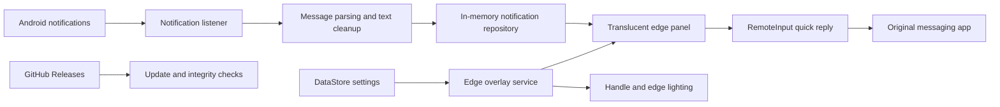

[한국어](README.md) | **English**

<div align="center">


# Slivue

**Keep your screen. Check your notifications.**

Read recent notifications and send supported quick replies from the edge of your screen.

[](https://github.com/DevDooly/Slivue/releases/latest)
[](https://github.com/DevDooly/Slivue/actions/workflows/release.yml)
[](https://github.com/DevDooly/Slivue/actions/workflows/codeql.yml)
[](https://developer.android.com/about/versions/oreo)
[](LICENSE)

[Download the latest APK](https://github.com/DevDooly/Slivue/releases/latest) · [Installation](#installation) · [Good Lock integration (Korean)](docs/Samsung_Edge_Integration_Guide.md) · [Development reference (Korean)](docs/DEVELOPMENT_REFERENCE.md) · [Report an issue](https://github.com/DevDooly/Slivue/issues)

</div>

> The hero image is a concept illustration. Actual screens vary with the device, Android version, theme, and your settings.

## What is Slivue?

Slivue is an open-source Android app that brings recent notifications into a panel at the edge of your screen. Check notifications while browsing, gaming, or watching a video, and reply from the panel when the original app provides an Android `RemoteInput` reply action.

On Samsung Galaxy devices, you can connect **Good Lock · One Hand Operation +** to open the panel with a gesture. Other Android devices can use Slivue's left or right edge handle.

The app was renamed Slivue in v1.3.18 to distinguish it from another developer's similarly named app; it is not that app's official successor or an affiliated product. The Android package identifier remains `com.devdooly.notificationedge` for installation and settings compatibility. Existing users can update without uninstalling.

## Midnight Rail design

The settings and notification panel share the icon's navy-and-blue palette. The panel header keeps the title, notification count, and action buttons on one row at supported widths. [Header screenshot](docs/images/slivue-header-single-row.png) · [Design reference (Korean)](docs/MIDNIGHT_RAIL_DESIGN.md)

As of v1.3.26, settings are organized into four groups: **Notifications**, **Appearance**, **Behavior & integrations**, and **About**. Expand **Notification filters** once to manage blocked keywords and excluded apps directly. Font settings also need only one expansion. State summaries, larger touch targets, and layouts for large text make settings easier to scan while preserving your existing preferences.

## Features

| Feature | What it does |
| --- | --- |
| Edge notification panel | Open a translucent panel to view recent notifications and conversation updates. |
| Quick replies | Reply to supported notification actions and see your sent reply in the same conversation card. |
| Cleaner conversations | Remove duplicate sender prefixes in one-to-one messages while keeping speaker labels in group conversations. |
| Notification filters | Exclude apps or hide notifications containing blocked keywords. These filters control Slivue's display, not delivery in the original app. |
| Appearance controls | Adjust the handle's side, position, size, color, and opacity; panel width; fonts; and edge lighting. |
| System navigation | Use Android's Back button or gesture to close the keyboard and panel in stages. |
| External launch options | Open the panel using a launcher shortcut, Good Lock, or explicitly enabled external commands. |
| GitHub updates | Check GitHub Releases and start an APK download and system installation when you choose to update. |
| Korean and English | Localized screens, permission guidance, errors, and time labels. Android 13 and later support a separate system app-language setting. |

## Installation

### 1. Download the APK

Download the versioned `Slivue-vX.Y.Z.apk` from this repository's [latest release](https://github.com/DevDooly/Slivue/releases/latest). Older releases retain their original APK names.

Use this repository's GitHub Releases rather than an unverified mirror. Compare the downloaded file's SHA-256 hash with its accompanying `.sha256` file:

```powershell
Get-FileHash .\Slivue-vX.Y.Z.apk -Algorithm SHA256
```

```bash
sha256sum ./Slivue-vX.Y.Z.apk
```

**Google Play publication is still being prepared.** The store descriptions and preview in this repository are preparation materials, not a published Play listing or proof of approval. See the [Google Play launch plan (Korean)](docs/GOOGLE_PLAY_LAUNCH_PLAN.md).

### 2. Review and grant permissions

Follow the permission cards in Slivue's settings. After granting or declining a permission in Android's settings, use **Back** to return to Slivue; the permission state refreshes without restarting the app. Battery-optimization settings follow the same return flow.

| Permission or system access | Purpose |
| --- | --- |
| Notification access | Read notification titles, content, and reply actions. It also enables access to active media sessions for the optional pause-before-opening feature. |
| Display over other apps | Show the edge handle and edge lighting while you use other apps. |
| Send notifications | Show Slivue's background-service status notification. This is separate from permission to read other apps' notifications. |
| Install unknown apps | Open Android's installer only when you choose to install an update from the GitHub APK distribution. |

If installation is blocked, review the device's security message and verify the source and SHA-256 first. Installation protections and options differ by Android and One UI version; do not leave a security protection disabled after installing.

### 3. Enable the edge handle

1. Review the required permission states in settings.
2. Turn on **Screen edge handle**.
3. Swipe the handle to check that the panel opens.
4. If background operation is restricted, review your device's battery-optimization settings for Slivue.

Edge lighting works independently of the handle. Turning off **Show edge handle** makes the handle invisible but does not disable its swipe area; use **Screen edge handle** to disable the handle itself.

## Display language

Slivue supports Korean and English. It follows the device language by default and falls back to English for unsupported languages.

- **Android 13 and later:** Select a language in Android settings under `Apps → Slivue → Language` or `System → Languages → App languages`. The path varies by manufacturer.
- **Android 8–12:** Change the device language to Korean or English. There is no separate language selector inside Slivue.
- Messages, sender names, custom font names, blocked keywords, and release notes fetched from GitHub remain in their original language. Slivue does not automatically translate messages.

See the [localization guide (Korean)](docs/LOCALIZATION_GUIDE.md) for development and verification details.

## Open with a Good Lock gesture

On supported Samsung Galaxy devices, use One Hand Operation + to open the panel without a visible Slivue handle:

1. Install **Good Lock** and **One Hand Operation +** from Galaxy Store.
2. Choose a handle and gesture in One Hand Operation +.
3. Set its action to **Home screen shortcuts**, then select Slivue's **Open Slivue notification panel** shortcut. This requires v1.3.24 or later. If the shortcut is missing, launch Slivue once and reopen the list. Shortcut labels may vary with the device language.
4. In Slivue, enable **Pause video before opening the panel** if you want to reduce automatic picture-in-picture transitions, and grant notification access.
5. Test the gesture, then turn off **Show edge handle** if you do not want the visible handle. Its swipe area remains active unless you disable **Screen edge handle**.

The shortcut route was verified with video playback on a Galaxy S23 Ultra running Android 16 / One UI 8.5 without triggering PiP. An existing **Launch application → Slivue** assignment does not change automatically and may still trigger PiP. This is not a guarantee for every video app, device, or OS combination. The pause option does not resume an already paused video or automatically resume playback when the panel closes; recognized music-only apps are excluded from this pause behavior.

See the [Samsung Good Lock integration guide (Korean)](docs/Samsung_Edge_Integration_Guide.md) for screenshots and gesture recommendations.

## Privacy and security

- Notification display, grouping, and filtering are processed on the device. The current implementation does not upload notification content or replies to a Slivue developer server.
- When you send a quick reply, Android passes it to the original messaging app through its notification action. That app handles subsequent delivery under its own policies.
- Notification history is held in app memory, with limits of 150 notifications and 50 messages per notification. Notifications removed from Android's notification shade may remain in Slivue's in-memory history. After the app process restarts, active system notifications can be read again.
- Settings, including detected apps, excluded apps, and blocked keywords, are saved locally. Android backup is enabled for settings, so backup and restoration may occur according to the device's backup settings. Device-to-device transfer can also depend on the OS and manufacturer.
- Imported font files are copied into the app's internal storage. Selected Google Fonts use the Google Play services font provider and may require a download.
- Internet access is also used to check GitHub Releases and download an APK when you choose to update. Downloads are limited to allowed HTTPS hosts, and a release SHA-256 value, when available, is checked before installation.
- Diagnostic mode is optional and expires after 12 hours. Some sensitive patterns are masked, but diagnostic text is **not guaranteed to be anonymous**: names or message content may remain. Review it before copying or sharing it.
- The current app does not include advertising, analytics/tracking, login, or in-app billing SDKs in its runtime dependencies.

Notification access is powerful and can expose the content of other apps' notifications to Slivue. You can revoke it in Android settings at any time. These implementation notes are not a completed Google Play privacy policy or Data safety declaration; see the [privacy and Data safety preparation document (Korean)](docs/GOOGLE_PLAY_PRIVACY_AND_DATA_SAFETY.md).

## Architecture



`EdgePanelActivity` hosts the translucent panel, while `EdgeOverlayService` manages the handle and edge lighting. Android's Back navigation closes the keyboard and panel. `MainActivity` acts as a lightweight launcher, and the full settings interface runs in `SettingsActivity`.

## Development

| Component | Current configuration |
| --- | --- |
| Language | Kotlin 2.0.21 |
| UI | Jetpack Compose · Material 3 |
| Minimum Android version | Android 8.0 · API 26 |
| Compile / target SDK | API 34 |
| Java | JDK 17 |
| State and preferences | Kotlin Coroutines · Flow · DataStore |
| Tests | JUnit · MockK · Turbine · Robolectric · Compose UI Test |

### Build locally

Install Android SDK 34 and JDK 17, then run from the repository root:

```powershell
.\gradlew.bat testDebugUnitTest compileDebugKotlin assembleDebug lintRelease
```

Release APKs require separate signing configuration. Never commit private keys or passwords. See the [signing-key rotation runbook (Korean)](docs/SIGNING_KEY_ROTATION_RUNBOOK.md) and `keystore.properties.example`.

The existing GitHub APK distribution is not yet a Play-ready build: Google Play preparation includes the target SDK, signing, AAB distribution, permissions, update flow, and privacy disclosures. The [launch plan (Korean)](docs/GOOGLE_PLAY_LAUNCH_PLAN.md) tracks that work; its dated policy findings must be rechecked before submission.

### Source layout

```text
app/src/main/java/com/devdooly/notificationedge/
├─ data/       Models, notification repository, settings, updater
├─ service/    Notification listener, overlays, boot, external commands
├─ ui/
│  ├─ overlay/ Translucent panel, notification cards, replies, lighting
│  ├─ settings/ Permissions, behavior, appearance, filters, updates
│  └─ theme/   Colors, fonts, Compose theme
└─ util/       Message parsing, text cleanup, diagnostics, helpers
```

GitHub Actions runs unit tests, release builds, and CodeQL analysis. Release verification also checks signed in-place upgrades on API 26 and 35; the device-test workflow provides additional scheduled and manually triggered coverage.

## Google Play listing materials

- [Korean / English description preview — HTML source](docs/google-play/index.html): GitHub displays the source file, not a hosted website. Download the repository, then open `docs/google-play/index.html` locally in a browser to use the language switcher.
- [English Play Console listing text](docs/google-play/listings/en-US/): copy-ready title, short description, and full description files.
- [Google Play launch plan (Korean)](docs/GOOGLE_PLAY_LAUNCH_PLAN.md): outstanding work before submission.

These materials do not publish the app to Google Play, complete a policy review, or provide a live store download link.

## Documentation

The following project documents are currently in Korean:

- [Localization guide (Korean)](docs/LOCALIZATION_GUIDE.md)
- [Google Play launch plan (Korean)](docs/GOOGLE_PLAY_LAUNCH_PLAN.md)
- [Privacy, permissions, and Data safety preparation (Korean)](docs/GOOGLE_PLAY_PRIVACY_AND_DATA_SAFETY.md)
- [Play signing and monetization strategy (Korean)](docs/GOOGLE_PLAY_SIGNING_AND_MONETIZATION.md)
- [Source analysis and hardening plan (Korean)](docs/PROJECT_SOURCE_ANALYSIS_AND_HARDENING_PLAN.md)
- [Development and architecture reference (Korean)](docs/DEVELOPMENT_REFERENCE.md)
- [One UI release checklist (Korean)](docs/ONE_UI_RELEASE_CHECKLIST.md)
- [Signing-key rotation runbook (Korean)](docs/SIGNING_KEY_ROTATION_RUNBOOK.md)
- [UI specification (Korean)](docs/UI_SPECIFICATION.md)
- [Pending issues (Korean)](docs/PENDING_ISSUES.md)
- [Icon design notes (Korean)](docs/App_Icon_Concepts.md)

## Known limitations

- Quick replies require an Android `RemoteInput` reply action in the original notification. Not every app or notification supports them.
- Manufacturer battery policies may affect background operation.
- Full-screen videos, games, and PiP behavior vary by app, launch method, device, and Android version.
- APK installation and update permissions vary by Android and One UI version.
- Filters affect which notifications appear in Slivue; they do not block messages or notifications in the original app.

## Contributing and support

Open a [GitHub issue](https://github.com/DevDooly/Slivue/issues) with reproduction steps, your device model, and Android / One UI version. Do not attach private notification text, phone numbers, account information, or signing-key material. Review diagnostic output before sharing it.

## License

Slivue is available under the [Apache License 2.0](LICENSE).
